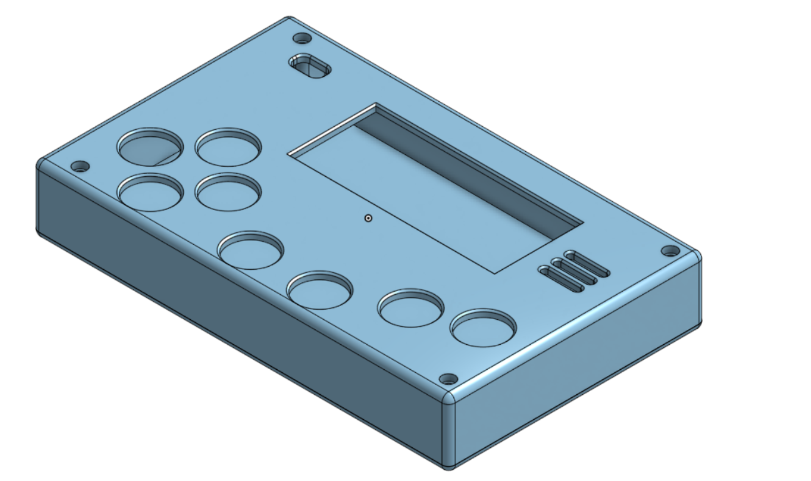

# LoverBoy


[](LICENSE)

**Idioma:** [English](README.md) | Português

> *Um projeto de paixão.*


Um console portátil estilo arcade inspirado no Game Boy, construído do zero com uma LILYGO ESP32-S3, componentes eletrônicos básicos, uma PCB customizada, uma carcaça impressa em 3D e um firmware C++ modular com seis jogos.

## Por que existe

O LoverBoy é um projeto pessoal e educacional, iniciado com os recursos e o espaço maker do Colégio Técnico da UFMG (Coltec) e em constante evolução durante minha graduação em Ciência da Computação (DCC/UFMG). O objetivo é criar uma plataforma modular e robusta de hardware e software, desenvolvendo habilidades práticas em:

- **Arquitetura de software:** Sistema operacional organizado por responsabilidades, com classes abstratas ditando o ciclo de vida dos jogos (padrão Template Method).
- **Programação de baixo nível:** Interação direta com GPIOs, temporizadores PWM e periféricos do microcontrolador.
- **Desenvolvimento de hardware:** Montagem de circuitos, soldagem, integração de componentes e bateria recarregável.
- **Modelagem e impressão 3D:** Carcaça ergonômica personalizada projetada no Onshape e fabricada via impressão 3D FDM.

## Recursos

- **Seis jogos:** Crossy, Flappy, Frogger, Genius, Snake e Tetris a ~60 FPS com renderização por diferença, sem cintilação.
- **Recordes persistentes:** Top 3 de cada jogo salvo na Flash, com tela estilo arcade para inserir 3 iniciais.
- **Tutoriais integrados:** Controles e objetivos de cada jogo, acessíveis no carrossel do título (Jogar, Tutorial, Recordes).
- **Menu de configurações:** Volume, brilho, tema de cores (5 paletas), idioma e reset de recordes.
- **Interface bilíngue:** Inglês (padrão) e Português do Brasil, com letras acentuadas na fonte pixelada retrô.
- **Áudio não-bloqueante e controles responsivos:** Melodias por máquina de estados e botões com debounce e repetição automática que nunca travam a lógica dos jogos.

Arquitetura, estrutura do código e como adicionar um jogo: **[Documentação do Firmware](firmware/README-pt.md)**.

## Hardware

| Peça | Detalhes |
|---|---|
| **Placa** | LILYGO T-Display ESP32-S3 (TFT de 1.9" 170x320 integrada) |
| **Entradas** | 8 botões táteis (D-Pad, Start, Select, A, B) |
| **Áudio** | 1 buzzer passivo para melodias e efeitos sonoros |
| **Alimentação** | Bateria LiPo 3.7V, módulo de carga TP4056 USB-C e chave deslizante |
| **PCB** | Placa-mãe through-hole de camada única projetada no EasyEDA ([`pcb/`](pcb/)) |
| **Carcaça** | Carcaça personalizada em duas partes impressa em 3D, projetada no Onshape ([`case/`](case/)) |

## PCB Customizada

Uma placa-mãe de camada única conecta a T-Display-S3, botões, buzzer, chave liga/desliga e o carregador TP4056. Trilhas e isolamentos largos permitem tanto a fabricação local (fresadora CNC / laser) quanto a encomenda em fábricas comerciais.

<p align="center">
  
  
</p>

Gerbers, BOM, fontes EDA, tabela de pinagem e parâmetros de fabricação: **[Documentação da PCB](pcb/README-pt.md)**.

## Carcaça

Uma carcaça em duas partes modelada no Onshape e projetada para impressão 3D FDM sem suportes.

<p align="center">
  
</p>

Meshes STL, fonte STEP, configurações de fatiamento e montagem: **[Documentação da Carcaça](case/README-pt.md)**. O modelo paramétrico está no [Onshape](https://cad.onshape.com/documents/1e7a1e5f646915cc7623cce0/w/f956c9933d51415f8580a5c6/e/0af3083584b46a6f4c513a5e?renderMode=0&uiState=6ae2d81bf7dd7a478c9b1770).

## Compilar e Gravar

Requer o pacote de placas `esp32:esp32` e a biblioteca `TFT_eSPI` configurada para a T-Display-S3 (`Setup206`). Caminho mais rápido com `arduino-cli`:

```bash
arduino-cli compile --fqbn esp32:esp32:lilygo_t_display_s3 firmware/LoverBoy
arduino-cli upload -p /dev/ttyACM0 --fqbn esp32:esp32:lilygo_t_display_s3 firmware/LoverBoy
```

Para os pré-requisitos completos, Windows (Arduino IDE) ou WSL (`./build_and_upload.sh -p COM7`), veja a **[Documentação do Firmware](firmware/README-pt.md#compilar-e-gravar)**.

## Estrutura do Projeto

```text
loverboy/
├── README.md / README-pt.md        # Visão geral (inglês / português)
├── LICENSE                         # Licença CC BY-NC-SA 4.0
├── LoverBoy_logo.png
├── build_and_upload.sh             # Script WSL de compilação e gravação em 1 comando
├── firmware/                       # Sketch Arduino (core, games, UI, i18n) & docs
├── pcb/                            # Gerbers, BOM, esquemático, fontes EasyEDA & docs
└── case/                           # Meshes STL, fonte STEP, renders & docs
```

## Licença

Todo este projeto — firmware, projeto da PCB e carcaça 3D — está licenciado sob a licença [Creative Commons Atribuição-NãoComercial-CompartilhaIgual 4.0 Internacional (CC BY-NC-SA 4.0)](LICENSE).

Criado por **[Vítor Paixão](https://github.com/paixonite)**.
