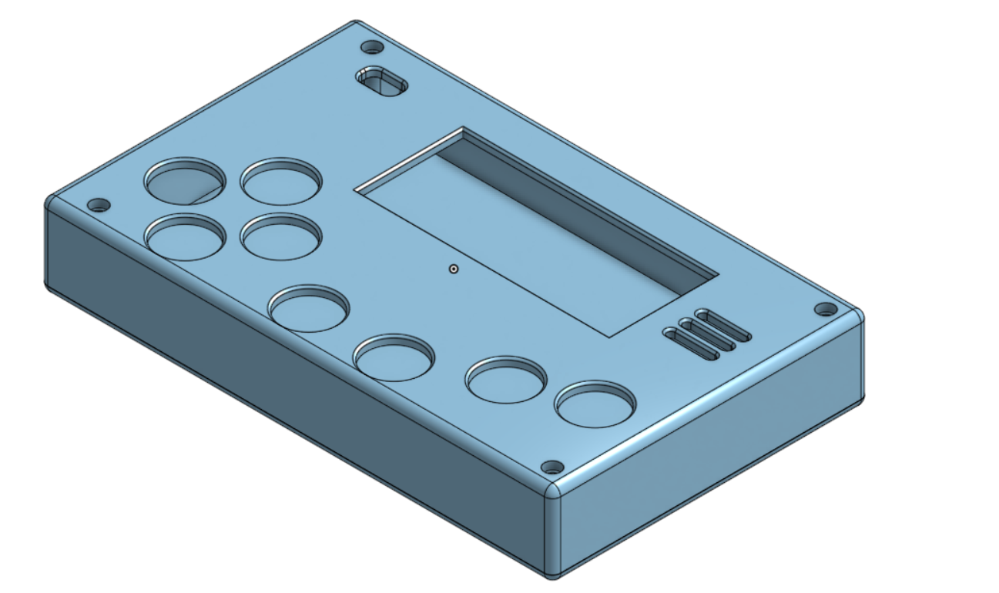

# LoverBoy

[](#-features)
[](#-hardware)
[](#-build--upload)

**Language:** English | [Português](./README-pt.md)

> *A passion project.*


A portable arcade game console inspired by the Game Boy, built from scratch with a LILYGO ESP32-S3, basic electronic components, a custom PCB, a 3D-printed enclosure, and a modular C++ firmware with six games.

[Why This Exists](#-why-this-exists) · [Features](#-features) · [Hardware](#-hardware) · [PCB](#-custom-pcb) · [Enclosure](#-enclosure) · [Build & Upload](#-build--upload) · [Structure](#-project-structure) · [Author](#-author)

## ▸ Why This Exists

LoverBoy is a personal educational project, started with the materials and maker space at Colégio Técnico da UFMG (Coltec) and still evolving through my Computer Science undergraduate studies (DCC/UFMG). It aims to build a robust, modular hardware and software platform while developing practical skills in:

- **Software architecture:** An operating system organized by responsibility, with abstract classes driving the game lifecycle (Template Method pattern).
- **Low-level programming:** Direct interaction with GPIOs, PWM timers, and microcontroller peripherals.
- **Hardware development:** Circuit assembly, soldering, component integration, and rechargeable battery management.
- **Modeling & 3D printing:** A custom ergonomic enclosure designed in Onshape and printed via FDM.

## ▸ Features

- **Six games:** Crossy, Flappy, Frogger, Genius, Snake, and Tetris at ~60 FPS with flicker-free delta rendering.
- **Persistent highscores:** Top 3 per game saved to Flash, with an arcade-style 3-initial entry screen.
- **In-game tutorials:** Controls and objectives for every game, reachable from the title carousel (Play, Tutorial, Highscores).
- **Settings menu:** Volume, brightness, color theme (5 palettes), language, and highscore reset.
- **Bilingual UI:** English (default) and Brazilian Portuguese, with accented letters on the retro pixel font.
- **Non-blocking audio & responsive input:** State-machine melodies and debounced, auto-repeating controls that never stall game logic.

Architecture, code layout, and how to add a game: **[Firmware Documentation](firmware/README.md)**.

## ▸ Hardware

| Part | Details |
|---|---|
| **Board** | LILYGO T-Display ESP32-S3 (integrated 1.9" 170x320 TFT) |
| **Inputs** | 8 push buttons (D-Pad, Start, Select, A, B) |
| **Audio** | 1 passive buzzer for melodies and sound effects |
| **Power** | 3.7V LiPo battery, TP4056 USB-C charging module, slide switch |
| **PCB** | Single-layer through-hole carrier board designed in EasyEDA ([`pcb/`](pcb/)) |
| **Enclosure** | Custom two-piece 3D-printed shell designed in Onshape ([`case/`](case/)) |

## ▸ Custom PCB

A single-layer carrier board connects the T-Display-S3, buttons, buzzer, power switch, and TP4056 charger. Wide traces and clearances allow both in-house fabrication (CNC milling / laser) and commercial PCB fabs.

<p align="center">
  
  
</p>

Gerbers, BOM, EDA sources, pinout table, and fabrication parameters: **[PCB Documentation](pcb/README.md)**.

## ▸ Enclosure

A two-piece enclosure modeled in Onshape and engineered for FDM printing without supports.

<p align="center">
  
</p>

STL meshes, STEP source, slicing settings, and assembly steps: **[Case Documentation](case/README.md)**. The live parametric model is on [Onshape](https://cad.onshape.com/documents/1e7a1e5f646915cc7623cce0/w/f956c9933d51415f8580a5c6/e/0af3083584b46a6f4c513a5e?renderMode=0&uiState=6ae2d81bf7dd7a478c9b1770).

## ▸ Build & Upload

Fastest path with `arduino-cli`:

```bash
arduino-cli compile --fqbn esp32:esp32:lilygo_t_display_s3 firmware/LoverBoy
arduino-cli upload -p /dev/ttyACM0 --fqbn esp32:esp32:lilygo_t_display_s3 firmware/LoverBoy
```

On Windows (Arduino IDE) or WSL (`./build_and_upload.sh -p COM7`), see the **[Firmware Documentation](firmware/README.md#-build--upload)**.

## ▸ Project Structure

```text
loverboy/
├── README.md / README-pt.md        # Project overview (English / Portuguese)
├── LoverBoy_logo.png
├── build_and_upload.sh             # WSL one-command build & flash script
├── firmware/                       # Arduino sketch (core, games, UI, i18n) & docs
├── pcb/                            # Gerbers, BOM, schematic, EasyEDA sources & docs
└── case/                           # STL meshes, STEP source, renders & docs
```

## ▸ Author

- **[Vítor Paixão](https://github.com/paixonite)**
