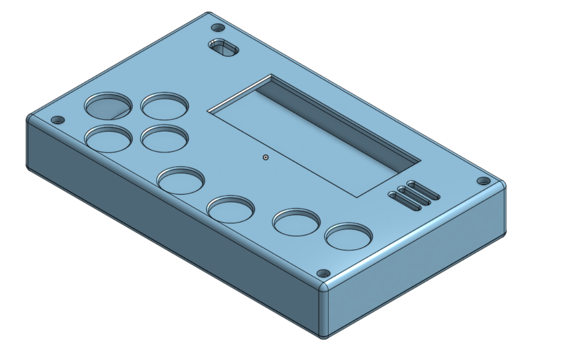
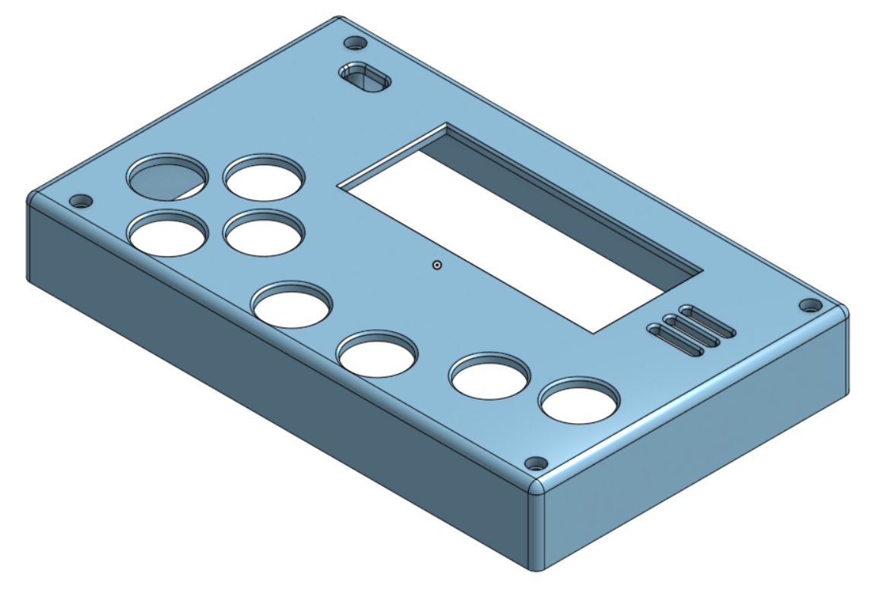
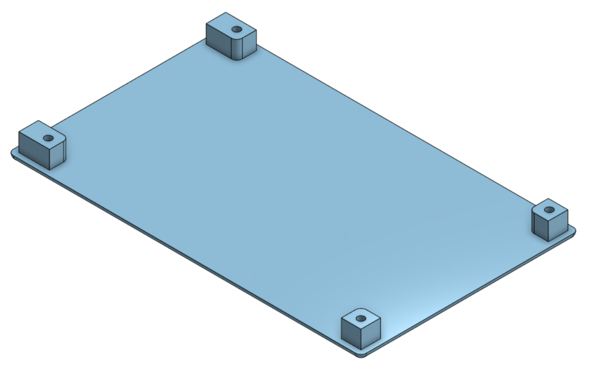

# 🖨️ LoverBoy - Carcaça & Impressão 3D

[English Version](./README.md)

[](https://cad.onshape.com/documents/1e7a1e5f646915cc7623cce0/w/f956c9933d51415f8580a5c6/e/0af3083584b46a6f4c513a5e?renderMode=0&uiState=6ae2d81bf7dd7a478c9b1770)



Carcaça personalizada em duas partes modelada no Onshape para o console portátil **LoverBoy**. Ela acomoda a PCB customizada, a placa LILYGO T-Display-S3, os botões táteis (push buttons), o buzzer, a chave liga/desliga, o módulo de carregamento USB-C TP4056 e a bateria recarregável LiPo em um formato portátil retro e ergonômico.

---

## 📸 Renderizações

<p align="center">
  
  
</p>

---

## 🔩 Parafusos & Ferragens (BOM)

| Item | Quantidade | Descrição | Observações |
| :--- | :---: | :--- | :--- |
| **Parafusos M2** | 4 | M2 × 16mm (Cabeça panela ou sextavada) | Atravessa a tampa frontal em direção à traseira |
| **Porcas M2** | 4 | Porcas sextavadas M2 padrão | Encaixadas nos alojamentos da tampa traseira |

---

## ⚙️ Orientações de Impressão 3D

A carcaça é uma impressão muito fácil, pesando cerca de 50g e com dimensões de aproximadamente 13x8cm.

| Parâmetro | Configuração Recomendada |
| :--- | :--- |
| **Material** | **PLA** (PETG também funciona muito bem) |
| **Altura de Camada** | **0.20 mm** (ou 0.16 mm para curvas externas mais suaves) |
| **Preenchimento (Infill)** | **15% – 20%** (Giroide) |
| **Paredes / Perímetros** | **3 paredes** |
| **Orientação de Impressão** | Imprimir ambas as peças **com a face plana apoiada diretamente na mesa** |
| **Suportes** | **Não são necessários!** Projetado para imprimir sem qualquer suporte |

---

## 🛠️ Guia de Montagem

1. **Inserir as Porcas M2:** Coloque as 4 porcas M2 nos seus alojamentos dentro da tampa traseira.
2. **Posicionar a PCB:** Encaixe a PCB montada do LoverBoy na tampa frontal e feche com a tampa traseira.
3. **Fixar:** Insira os 4 parafusos M2 × 16mm pelos furos dos cantos da tampa frontal e rosqueie nas porcas M2 da tampa traseira.

---

## 📂 Estrutura de Diretórios

```text
case/
|-- README.md                   # Documentação em Inglês
|-- README-pt.md                # Esta documentação (Português)
|-- source/
|   `-- assembly.step           # Montagem em modelo sólido STEP (padrão universal CAD)
|-- stl/
|   |-- front_cover.stl         # Mesh da tampa frontal pronta para fatiamento
|   `-- back_cover.stl          # Mesh da tampa traseira pronta para fatiamento
`-- renders/
    |-- render_assembly.png     # Render da carcaça montada
    |-- render_front.png        # Render da tampa frontal
    `-- render_back.png         # Render da tampa traseira
```

---

## 🌐 Modelo Paramétrico no Onshape

O modelo paramétrico original é mantido no **Onshape**:
- **Link Público no Onshape:** [LoverBoy Case no Onshape](https://cad.onshape.com/documents/1e7a1e5f646915cc7623cce0/w/f956c9933d51415f8580a5c6/e/0af3083584b46a6f4c513a5e?renderMode=0&uiState=6ae2d81bf7dd7a478c9b1770)
- Qualquer pessoa pode visualizar, medir, clonar ou criar branches do projeto diretamente no navegador, sem precisar instalar nenhum software.
